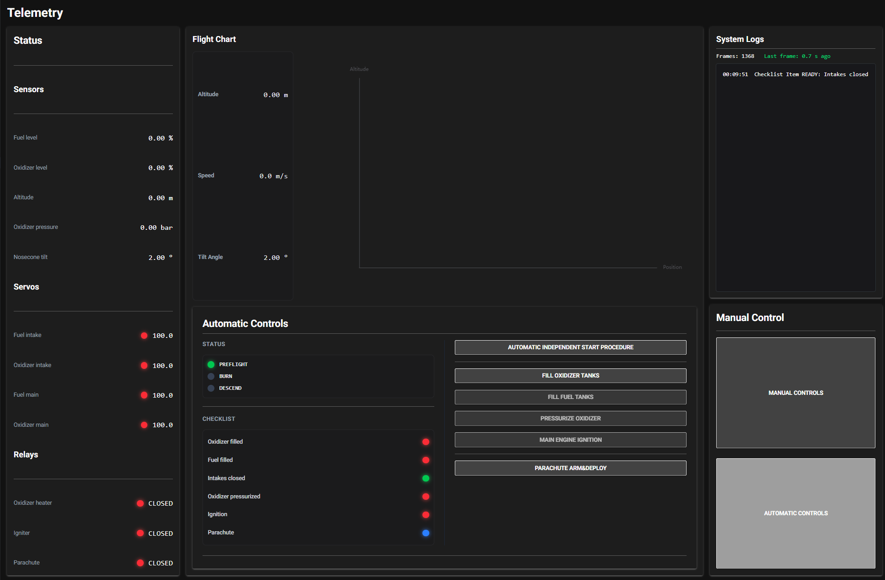
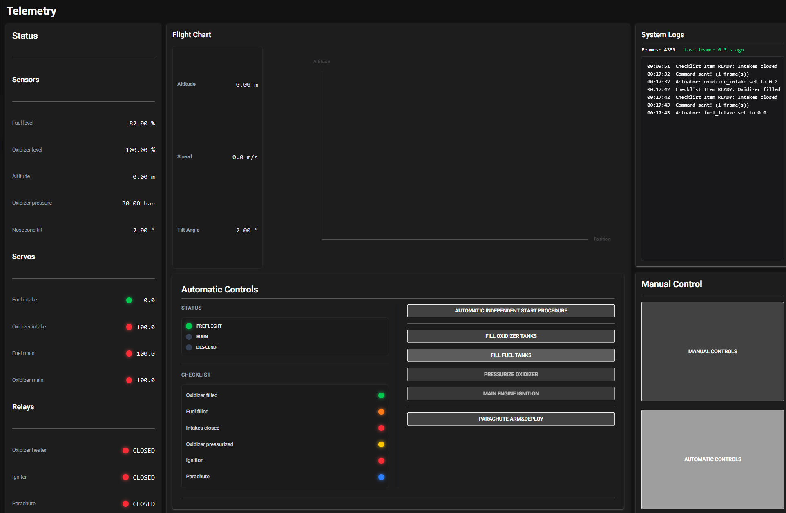
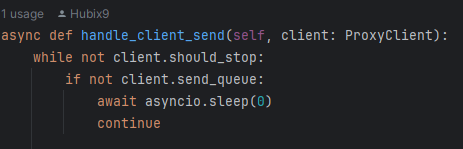

# Zadanie Rekrutacyjne do AGH Space Systems, Mateusz Lis:
Najważniejsza część to zawsze przezentacja, więc od tego zacznę.
Gdy uruchomimy całe rozwiązanie, ukaże nam się następujące menu: 

### Lewa kolumna
- Z lewej strony mamy podgląd wszystkich informacji od rakiety, w możliwie najbardziej czystej postaci z uwzględnieniem jednostek (jednostki są bardzo ważne)
### Panel środkowy:
- Górna część to w miare możliwości wizualny podgląd stanu rakiety,
jest tu umieszczony wykres który (WIP, nie zdążyłem) miał wyświetlać uproszczoną pozycje rakiety na "Mapie".
- Poniżej znajduje się główny panel sterujący (Automatyka). W tym panelu mamy możliwość przeprowadzenia w bezpieczny sposób kolejnych procedur startu rakiety.
### Prawa kolumna
- Z prawej strony są rzeczy nieco bardziej techniczne, z którymi niekoniecznie często użytkownik wchodzi w interakcje. Konsola to konsola, kto ma wiedzieć ten wie.  
- Poniżej jest możliwość przełączenia na tryb w pełni manualny
(Niekoniecznie kompletny, skupiłem się na automatyce), który pozwala osobno wchodzić w interakcje z każdym systemem rakiety.

Procedry Startowe są dosyć prostoliniowe, klikamy po kolei każdy guzik kiedy się tylko odblokuje (wyjątkiem jest spadochron który postanowiłem że powinien być zawsze odblokowany)
Ważna uwaga: przycisk na samej górze "Automatic Independent Start Procedure" jest niezaimplementowany, tylko wygląda.

 

Na obrazku panel w trakcie tankowania rakiety.

### Backend:
- Backend jest skomplikowany. Niestety musze zwrócić uwagę na lakonicznie opisaną dokumentację. Dużo czasu poświęciłem żeby to wykminić.
- Aplikacja to w zasadzie kolejny klient dla serwera proxy. Wykorzystałem fakt że w proxy jest uruchomiony frame mirroring, więc mogłem sobie to fajnie wykorzystać.
- Chciałem się bardziej skupić na backendzie. Chciałem aby mój projekt to była implementacja powered landing, ale niestety zauważyłem że symulator nie daje zbyt wielu możliwości wpływania na tor lotu rakiety, więc na chęciach się skończyło.
- Jeśli napotykasz problem z uruchomieniem mojego rozwiązania, to prawdopodobnie przyczyną jest to iż masz mniej niż 3 rdzenie w procesorze. Niestety zapewnione skrypty uprawiają busy waiting, więc to już 2 rdzenie, no a trzeci jest potrzebny na moje skrypty.

Przykład Busy Waitingu

### Lista featerów
- ui_client.py - **zaawansowany asynchroniczny menadżer komunikacji TCP Proxy** - wysyła i odbiera ramki do komunikacji z rakietą
- dynamiczne ui, nie wymagające reloadów po każdej akcji
- logi na żywo w konsoli
- monitorowanie połączenia
- kontroli LED stylizowane na kontrolki LED dynamicznie sygnalizujące statusy różnych przekaźników
- precyzyjne i uproszczone sterowanie serwomechanizmami
- tryb automatyczny z zaawansowanymi procedurami bezpieczeństwa ułatwiające przeprowadzenie startu rakiety 
- regulator ciśnienia w rakiecie (grzałka się wyłącza i włącza aby utrzymać ciśnienie zgodne z procedurami bezpieczeństwa)

### Czego brakuje:
- kalkulacja prędkości się czasem (zawsze) sypie
- niezaimplementowany przycisk do w pełni samodzielnego autonomicznego startu
- wykres się nie rysuje
- uruchomienie klienta ui podczas trwania symulacji może wywołać spam w konsoli

### Jak uruchomić?
1. Utwórz 3 terminale, każdy na osobny skrypt
2. py tcp_proxy.py
3. py tcp_simulator.py
4. py ui_client.py
Do przeprowadzania kolejnych symulacji nie trzeba resetować ui client, powinien sam sie przywrócić do stanu pierwotnego/zsynchronizować z stanem symulacji

### Autor: Mateusz Lis

